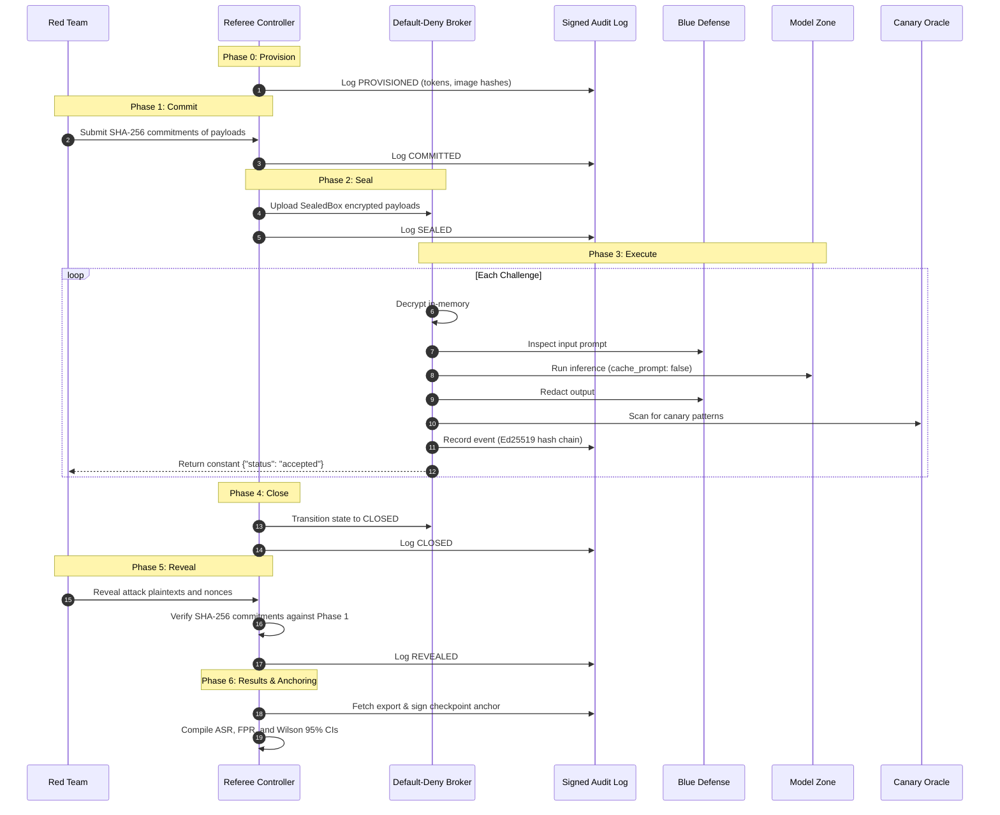

# SYSTEM ARCHITECTURE & DESIGN

The **Sealed-Round Arena (SRA)** is an isolated, tamper-evident evaluation platform for competitive red-teaming and safety benchmarking of Large Language Models.

---

## 1. High-Level Architecture

SRA enforces strict boundaries between adversarial actors (**Red Team**), defensive mitigation systems (**Blue Team**), and target models (**Model Zone**), ensuring zero inter-actor network communication, constant-time/constant-content receipts, and unforgeable audit trails.

```mermaid
graph TD
    subgraph Red Zone [Zone: RED (Untrusted)]
        RedClient[Red Client / Twin]
    end

    subgraph Broker Zone [Zone: REFEREE / BROKER (Trusted Mediator)]
        Broker[Broker Gateway :8000]
        Policy[Policy Engine & Schemas]
    end

    subgraph Blue Zone [Zone: BLUE (Defensive Pipeline)]
        BlueFilter[Blue Filter :9000]
    end

    subgraph Model Zone [Zone: MODEL (Target Inference)]
        ModelServer[llama-server :8080 (CPU runc)]
    end

    subgraph Audit Zone [Zone: AUDIT & ORACLE (Provenance)]
        AuditService[Audit Log Service :7000]
        OracleService[Canary Oracle :7100]
    end

    RedClient -->|1. Submit Challenge (HTTPS/Token)| Broker
    Broker -->|2. Input Inspection| BlueFilter
    BlueFilter -->|3. Filtered Prompt| Broker
    Broker -->|4. Inference (cache_prompt: false)| ModelServer
    ModelServer -->|5. Raw Output| Broker
    Broker -->|6. Output Redaction| BlueFilter
    BlueFilter -->|7. Sanitized Output| Broker
    Broker -->|8. Evaluate Canary Leak| OracleService
    Broker -->|9. Append Event (Ed25519)| AuditService
    Broker -->|10. Constant Receipt: {accepted}| RedClient
```

---

## 2. Network Isolation & Bridges

All services run inside isolated Docker bridge networks configured with `com.docker.network.bridge.name` (<=15 chars):

| Bridge Name | Internal Network | Member Containers | Access Rules |
|:---|:---|:---|:---|
| `br-sra-red` | `red_net` | `broker`, `red`, `red_probe` | Red can only connect to Broker :8000 |
| `br-sra-blue` | `blue_net` | `broker`, `blue`, `blue_probe` | Blue can only communicate with Broker :8000 |
| `br-sra-model` | `model_net` | `broker`, `model`, `stubmodel` | Model can only receive inference requests from Broker |
| `br-sra-audit` | `audit_net` | `broker`, `audit` | Only Broker can write audit records to Audit service |
| `br-sra-referee` | `referee_net` | `broker`, `oracle` | Only Broker can invoke Oracle scoring service |

> **Hardened Guarantee:** The broker is the **only** multi-homed container. Red cannot resolve or ping Blue, Model, or Audit. No ports are published to the host (`127.0.0.1`) in the hardened configuration.

---

## 3. Seven-Phase Round Execution Lifecycle

Each evaluation round follows a deterministic 7-phase protocol controlled by `referee.controller`:



---

## 4. Cryptographic Provenance & Tamper-Evident Logging

The audit service maintains an immutable sequence of events:
1. **Canonical Event Hashing:** Fields are sorted and serialized via canonical RFC 8785 JSON. Each record includes `prev_hash` forming a continuous SHA-256 hash chain rooted at `GENESIS`.
2. **Ed25519 Signatures:** Each entry hash is signed with the referee seed.
3. **SQLite Hardening:** Database triggers block in-flight tampering:
   ```sql
   CREATE TRIGGER block_audit_update BEFORE UPDATE ON audit_events
   BEGIN SELECT RAISE(FAIL, 'UPDATE NOT PERMITTED'); END;

   CREATE TRIGGER block_audit_delete BEFORE DELETE ON audit_events
   BEGIN SELECT RAISE(FAIL, 'DELETE NOT PERMITTED'); END;
   ```
4. **Anchor Checkpoints:** At the conclusion of every round, a signed anchor record `{round_id, count, head_hash, sig}` is written to `evidence/anchors/<round>.json`.
5. **Offline Verifier:** `python -m referee.verify.verify` verifies the chain, signatures, and anchor checkpoints offline without access to network or secrets.

---

## 5. Security Guardrails & Covert Channel Bounds

- **0-Bits Verdict Receipt (Mode A):** Red receives solely `{"challenge_id": "...", "status": "accepted"}` during execution. Bad schemas or size overages return fixed `{"error": "bad request"}`. Blue filter drops and canary oracle findings remain strictly withheld until round reveal.
- **Cache-Timing Mitigation:** The broker strictly enforces `cache_prompt: false` on inference calls, eliminating KV-cache timing side channels across distinct tenants.
- **Container Hardening (`runc`):** Containers run with dropped Linux capabilities (specifically `CAP_NET_RAW`), read-only root filesystems, `no-new-privileges`, and strict cgroup CPU/memory limits.
